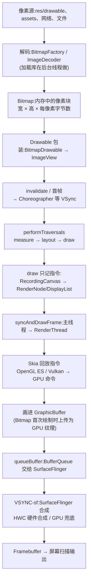

# 图片从代码到屏幕的全流程

> **本质**:一张图片要闯五关——**解码**(磁盘字节 → 内存像素)、**进 View 树**(被 Drawable / ImageView 包装)、**录制**(主线程把 draw 调用记成 DisplayList)、**GPU 绘制**(RenderThread 用 Skia 真正画出像素)、**系统合成**(SurfaceFlinger 把所有窗口拼成一帧)。前两关决定**内存占用**,后三关决定**流畅度**;OOM、模糊、掉帧各自能定位到具体关卡。

## 全景流程



## 阶段 1:解码——磁盘字节变成内存像素

### 图片从哪来

- **APK 内资源**:`res/drawable-*dpi` 在编译期被 aapt2 处理成资源 id,运行时按设备密度选目录 → [02-图片尺寸与组件不匹配](02-图片尺寸与组件不匹配.md) 的密度缩放部分。
- **assets / 本地文件 / 网络**:`decodeStream` / `decodeFile`,或交给 Glide、Coil。
- **同一张图的两种身份**:`Bitmap`(真实像素集合)与 `Drawable`(可绘制的抽象,负责缩放、平铺、圆角等绘制策略)。

### 解码产物:Bitmap 的内存账

```text
内存 ≈ 宽 × 高 × 每像素字节数
```

| Bitmap.Config | 每像素字节 | 透明 | 说明 |
| --- | --- | --- | --- |
| ALPHA_8 | 1 | — | 只有 alpha,做遮罩 |
| RGB_565 | 2 | 无 | 省一半内存,Glide 对不透明图可配置使用 |
| ARGB_8888 | 4 | 有 | 默认格式 |
| RGBA_F16 | 8 | 有 | HDR/高精度 |
| HARDWARE | ~4(存显存) | 有 | API 26+ 直接解码进 GPU,不占 Java/native 堆 |

- 一张 4000×3000 的相机原图按 ARGB_8888 解码 ≈ **45.8 MB**——这就是「小图挂大图 OOM」的来源。
- **Android 8.0 起**,像素数据存在 native 堆(Java 对象只是壳),但 allocation 仍随 GC 回收,`getAllocationByteCount()` 可查真实占用。

### 自动密度缩放

`BitmapFactory.decodeResource` 默认 `inScaled = true`:解码尺寸 = 原始尺寸 × (屏幕 dpi ÷ 资源目录 dpi)。同一张图放错 density 目录,解码产物可能凭空放大/缩小数倍 → 详见 [02-图片尺寸与组件不匹配](02-图片尺寸与组件不匹配.md)。

### 加载库替你做的事

Glide / Coil 在 **IO 线程池**解码,并自动:按目标 View 测量尺寸做 `inSampleSize` 下采样、内存 LRU + 磁盘缓存、生命周期绑定(页面销毁取消请求)。手写 `BitmapFactory` 时这些全要自己实现。

## 阶段 2:进入 View 树

```java
// setImageBitmap 内部就是把 Bitmap 包一层 BitmapDrawable
imageView.setImageBitmap(bitmap);
// ≈ imageView.setImageDrawable(new BitmapDrawable(getResources(), bitmap));
```

- 新 Drawable 的 `intrinsicWidth/Height` 可能变化 → `setImageXxx` 会同时触发 `requestLayout` + `invalidate`。
- `src`(ImageView 内容,受 ScaleType 控制)与 `background`(直接铺满 View,**没有 ScaleType**)是两条不同路径 → 详见 [02-图片尺寸与组件不匹配](02-图片尺寸与组件不匹配.md)。

## 阶段 3:VSync 驱动三大流程与指令记录

### 首帧与重绘

- **首帧**:`setContentView` → `WindowManager.addView` 创建 `ViewRootImpl` → 界面可见前发起第一次 `performTraversals`。
- **重绘**:`invalidate()` → `ViewRootImpl.scheduleTraversals()` → `Choreographer` 注册回调,等 **VSync** 到来才执行,避免一帧内重复布局。
- Choreographer 回调顺序:`INPUT → ANIMATION → TRAVERSAL(布局绘制) → COMMIT`。

### performTraversals 三部曲

| 步骤 | 做什么 | 与图片的关系 |
| --- | --- | --- |
| **measure** | 自顶向下确定每个 View 的尺寸(MeasureSpec) | ImageView 结合 ScaleType、`adjustViewBounds`、intrinsic 尺寸决定自身测量值 |
| **layout** | 确定每个 View 在父容器中的位置 | 得到 View 的最终绘制区域(px) |
| **draw** | 生成绘制指令 | `ImageView.onDraw()` → `drawable.draw(canvas)` → `canvas.drawBitmap()` |

### 硬件加速下 draw 不画像素,只记指令

```text
draw(canvas)                        // canvas 实为 RecordingCanvas
├─ drawBackground()                 // 背景指令
├─ onDraw()                         // ImageView 画自己的 drawable → 一条 drawBitmap 指令
├─ dispatchDraw()                   // 递归记录子 View
└─ onDrawForeground()               // 前景/滚动条
```

- 每个启用硬件加速的 View 对应一个 **RenderNode**,记录的指令集合即 **DisplayList**(API 29 起 RenderNode/RecordingCanvas 转正)。
- **局部刷新原理**:`invalidate` 只重录脏 View 的 DisplayList,树的其他部分直接复用。
- **属性动画便宜的原因**:平移/缩放/透明度只改 RenderNode 属性,连 DisplayList 都不用重录。
- 关闭硬件加速(Software Layer / `setLayerType(LAYER_TYPE_SOFTWARE)`):`draw` 在**主线程**用 CPU 真正把像素画进 Bitmap 缓冲——大图软渲染是卡顿重灾区。

## 阶段 4:RenderThread 与 GPU 绘制

- 主线程调用 `ThreadedRenderer.syncAndDrawFrame()` 把 RenderNode 树**同步**给 **RenderThread**(UI Thread 从此解放,可以响应下一帧的输入)。
- RenderThread 遍历 RenderNode 树,回放 DisplayList → **Skia**(Android 9 起默认后端,底层 OpenGL ES / Vulkan)→ 生成 GPU 命令,渲染进 Surface 的 **GraphicBuffer**。

### Bitmap → GPU 纹理(图片特有的一步)

- 软件解码出的 Bitmap 像素在 RAM 里,GPU 看不见;**首次绘制时整块上传为 GPU 纹理**,缓存在 HWUI 的 **TextureCache**(LRU,上限设备相关,默认几十 MB)。
- 纹理被驱逐后每次显示都要重传 → 大图列表反复滑动掉帧的典型根因。
- **HARDWARE Config** 的 Bitmap 解码直接进显存,上传成本为 0;但 `getPixels()`、软件 Canvas 会直接抛异常。
- **纹理上限**:`GL_MAX_TEXTURE_SIZE` 常见 4096~16384,超限的纹理创建失败(表现为图不显示/黑块);Glide 会读取该上限自动降采样规避。

## 阶段 5:BufferQueue 与 SurfaceFlinger 合成

```text
App(RenderThread)                SurfaceFlinger(独立进程)
dequeueBuffer  ─────────────────────►  (空闲缓冲)
  GPU 绘制
queueBuffer   ─────────────────────►  收到通知,标记该 Layer 有新帧
                                      VSYNC-sf 到来:acquire 所有 Layer 最新帧
                                      HWC 硬件合成 / GPU 兜底合成
               ◄───────────────────  releaseBuffer(复用)
                                      写 framebuffer → 屏幕扫描输出
```

- **每个窗口一个 Surface**,内核是 **BufferQueue**:App 是生产者,SurfaceFlinger 是消费者,通常 3 个 GraphicBuffer 轮转(三缓冲)。
- **合成两条路**:HWC(Hardware Composer)用显示控制器 overlay 直通,零 GPU 成本、省电;层数过多/带特殊效果时回退 GPU(Client)合成。
- App 的 VSync 与 SF 的 VSync 有相位差:**App 先渲染,SF 后合成**,同在 16.6ms(60Hz)预算内串行接力。

## 线程视角总表

| 阶段 | 线程 / 进程 | 产物 |
| --- | --- | --- |
| 网络请求、解码 | 加载库 IO 线程 | Bitmap |
| measure / layout / draw | 主线程(UI Thread) | RenderNode / DisplayList |
| 属性同步(sync) | 主线程 | 同步后的 RenderNode 树 |
| Skia 回放 + 纹理上传 | RenderThread | GPU 命令 → GraphicBuffer |
| 提交缓冲 | RenderThread | BufferQueue |
| 合成上屏 | SurfaceFlinger 进程 | framebuffer |

## 掉帧时往哪看

| 症状 | 指向 | 典型原因 |
| --- | --- | --- |
| `Choreographer#doFrame` 在主线程超时 | 阶段 2/3 | 布局层级过深、`onDraw` 里做解码/分配 |
| 主线程很快但仍掉帧,RenderThread 忙 | 阶段 4 | 大纹理反复上传、过度绘制、纹理被 TextureCache 驱逐 |
| App 帧准时但整体延迟 | 阶段 5 | Layer 过多导致 HWC 放弃、回退 GPU 合成 |

用 Perfetto 抓取 `doFrame` / `syncAndDrawFrame` / RenderThread 轨道即可归因 → [冷启动根因与指标搭配](../SmartPerfetto/冷启动根因与指标搭配.md)。

## 面试高频速答

### setImageResource 之后到底发生了什么?

<details>
<summary>答案</summary>
解码(通常已被加载库在后台完成)→ 包成 BitmapDrawable 设置给 ImageView,触发 requestLayout + invalidate → ViewRootImpl 经 Choreographer 等 VSync → 主线程 measure/layout/draw,draw 阶段把 drawBitmap 记入该 View 的 RenderNode DisplayList → syncAndDrawFrame 同步到 RenderThread → Skia 回放指令,Bitmap 首次绘制上传为 GPU 纹理,画进 GraphicBuffer → queueBuffer 交给 SurfaceFlinger → VSYNC-sf 时 HWC/GPU 合成到 framebuffer → 屏幕扫描显示。
</details>

### 为什么主线程不卡,图片还是掉帧?

<details>
<summary>答案</summary>
绘制执行在 RenderThread:纹理上传(超大图、TextureCache 驱逐后重传)、GPU 命令过多(过度绘制)、复杂特效(模糊/圆角离屏)都在渲染线程/GPU 上耗时,主线程只负责录指令。Perfetto 中看 RenderThread 的 DrawFrames 时长即可确认。
</details>

### DisplayList 局部刷新为什么能加速?

<details>
<summary>答案</summary>
每个 View 的绘制指令缓存为自己的 RenderNode;invalidate 只重录脏 View 的 DisplayList,父容器和兄弟节点复用;RenderThread 只回放受影响的部分。而属性动画(平移/缩放/透明度)甚至不重录,只更新 RenderNode 属性。
</details>

## 互链

- 尺寸不匹配时的缩放、采样与内存后果:[02-图片尺寸与组件不匹配](02-图片尺寸与组件不匹配.md)
- 用 Perfetto 归因渲染性能:[冷启动根因与指标搭配](../SmartPerfetto/冷启动根因与指标搭配.md)
