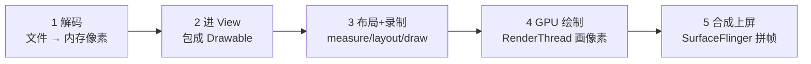

# 图片从代码到屏幕的全流程

> **本质**:一张图片上屏就五步:**解码 → 进 View → 记指令 → GPU 画 → 系统合成**。每步只需知道"干了什么";最后看"哪里能优化"。

## 全景流程

## 五个阶段分别干了什么

### 1 解码:文件变像素

- PNG/JPEG/WebP 是压缩格式,GPU 看不懂;先解码成 **Bitmap**——内存里一个"宽 × 高"的像素块。
- **内存 = 宽 × 高 × 每像素字节数**(ARGB_8888 每像素 4 字节):一张 4000×3000 的照片 ≈ 45MB。图片 OOM 全出在这一步。
- 实际开发由 Glide/Coil 在**后台线程**解码,主线程只拿结果。

### 2 进 View 树

- `imageView.setImageBitmap(bitmap)`:把 Bitmap 包成 Drawable 交给 ImageView,同时触发"这一帧要重新画"(invalidate)。

### 3 主线程:算大小、定位置、记指令

- **measure** 算出 View 多大,**layout** 定出 View 在哪。
- **draw**:硬件加速下不真画像素,只把"这里要画这张图、什么位置多大"记成一张**指令清单**(DisplayList)。
- 重绘时只重新记录变化的 View,其余复用——这就是局部刷新。

### 4 渲染线程:GPU 真正画

- 指令清单交给独立的 **RenderThread**,由 Skia 翻译成 GPU 命令,把像素画进一块缓冲区。
- Bitmap **第一次画**时,像素要从内存上传给 GPU;图越大传得越慢——这是大图掉帧的直接原因。

### 5 系统合成:上屏

- 每个窗口画好一块缓冲区,交给系统进程 **SurfaceFlinger**:它把状态栏、App 窗口等所有图层拼成一帧,写进屏幕。
- 60Hz 屏一帧预算 **16.6ms**,"布局+录制 → GPU 画 → 合成"接力完成,谁超时谁掉帧。

## 线程视角速记

| 阶段 | 谁在干 |
| --- | --- |
| 1 解码 | 加载库后台线程 |
| 2、3 进 View + measure/layout/draw | 主线程 |
| 4 GPU 绘制 | RenderThread |
| 5 合成上屏 | 系统进程 SurfaceFlinger |

## 哪些阶段可以优化

### 阶段 1(收益最大):让 Bitmap 变小

- **按显示尺寸解码**:Glide `into(view)` 自动按 View 大小下采样;手动解码用 `inJustDecodeBounds` 先探尺寸,再按 `inSampleSize` 缩。
- **HARDWARE Bitmap**(Android 8.0 自带能力):`ImageDecoder.setAllocator(ALLOCATOR_HARDWARE)` 解码直接进显存——省内存、还省掉阶段 4 的上传;Glide 在 API 26+ 默认尽量启用(`disallowHardwareConfig()` 可关)。
- **RGB_565**:不透明的图省一半内存(Glide 可配置)。

### 阶段 2/3:少触发重活

- 减少布局层级:`requestLayout` 会从头量一整棵树。
- **Hardware Layer**(自带 API):静态但复杂的内容 `setLayerType(LAYER_TYPE_HARDWARE, null)` 缓存成纹理,做动画时直接挪纹理,不重画。
- 硬件加速默认开启(manifest `android:hardwareAccelerated`),别随手关——关了 draw 就变主线程 CPU 画图。

### 阶段 4:别让 GPU 做无用功

- 图太大就在阶段 1 解决,这里没法补救。
- 排查**过度绘制**:开发者选项「调试 GPU 过度绘制」,同一像素被叠画多次就是白干。

### 阶段 5:交给系统,基本不用管

- 窗口图层太多时 SurfaceFlinger 会放弃硬件合成、退回 GPU 合成,费电费时;正常开发不直接控制。

## 一句话总结

**解码管内存,绘制管流畅**:图 OOM → 治阶段 1;滑动掉帧 → 治阶段 3/4。

## 互链

- 尺寸不匹配、ScaleType 与采样细节:[02-图片尺寸与组件不匹配](02-图片尺寸与组件不匹配.md)
- 用 Perfetto 定位卡顿:[冷启动根因与指标搭配](../SmartPerfetto/冷启动根因与指标搭配.md)
