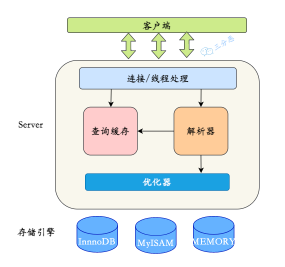
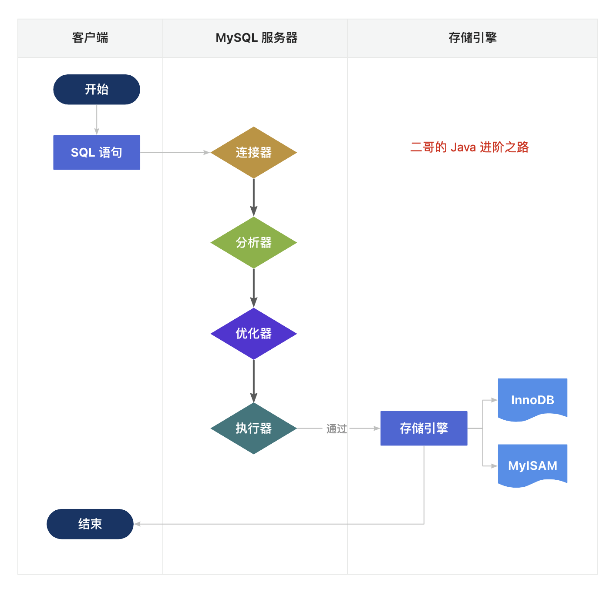

# 01-数据库架构

> 一句话本质：MySQL = 连接层管「谁能进来」、服务层管「SQL 怎么跑」、存储引擎管「数据怎么存」；一条 SQL 从业务代码到结果集，就是把这三层走一遍。

## 先看全景：一条 SQL 的旅程

$$
\text{代码业务请求} \xrightarrow{\text{连接池}} \text{SQL 预编译} \xrightarrow{\text{网络传输}} \text{数据库引擎执行 (事务/索引)} \xrightarrow{\text{结果集}} \text{ORM 映射为对象}
$$

分两段看：

- **应用 → 数据库**：业务代码从连接池拿一条长连接，SQL 预编译后经网络传输发给数据库引擎。
- **数据库 → 应用**：引擎执行（涉及事务、索引），结果集通过网络返回，ORM 把行数据映射成对象——业务代码拿到的是 `List<User>`，不是一行行裸数据。

数据库内部怎么接住这条 SQL？看三层架构。

## 三层架构

| 层 | 职责 | 关键点 |
| --- | --- | --- |
| 连接层 | 验证权限、连接管理 | 连接池提升连接处理效率 |
| 服务层 | 查询解析、优化、执行 | 解析器、优化器、执行器都在这层，是「大脑」 |
| 存储引擎层 | 数据的实际存储和提取 | 可插拔，默认 InnoDB |

记忆法：**连接层是门卫，服务层是大脑，存储引擎是仓库**。

## 一条查询 SQL 的完整执行链路

1. **客户端**把 SQL 发送到 MySQL 服务器。
2. **连接器**：与客户端建立连接、获取权限、管理连接。
3. **解析器**：检查语法是否合规，确认数据库、表、列都存在，做名称解析和权限验证。
4. **优化器**：生成执行计划——选哪些索引、多表连接顺序怎么排。
5. **执行器**：调用存储引擎的 API 读写数据。
6. **存储引擎**：查出数据，逐层返回给客户端，本次查询结束。

| 阶段 | 模块 | 一句话职责 |
| --- | --- | --- |
| 第 1~2 步 | 连接层 | 建连接、验权限、管连接 |
| 第 3~4 步 | 服务层 | 解析语法 → 优化出执行计划 |
| 第 5~6 步 | 执行器 + 存储引擎 | 执行器发号施令，引擎真正搬数据 |

> 查询走这条链路，增删改也是同一条，只是第 5 步之后多了事务与日志的戏份（见 [04-数据库事务](04-数据库事务.md)、[06-数据库日志](06-数据库日志.md)）。

## 连接管理：长连接 vs HTTP 网关

| 方式 | 原理 | 适用场景 |
| --- | --- | --- |
| TCP 长连接 + 连接池 | 应用与数据库通过 TCP 建长连接，由连接池复用 | 常规后端服务 |
| HTTPS + 云端网关连接池 | 应用发标准 HTTPS 请求，Body 里带 SQL 或查询条件；数据库网关在云端自己维护连接池，前端请求无状态随落随走 | Serverless 数据库（应用频繁启停，养不了长连接） |

长连接的两大好处：

- **性能**：后续 SQL 传输不需要重新 TCP 握手。
- **事务支持**：分布式事务、锁机制都依赖底层 TCP 驱动协议（如 MySQL 协议）。

## 面试怎么问

### 问题 1：MySQL 的架构分几层？各层职责？

参考答案

分三层（自上而下）：

1. **连接层**：验证权限、连接管理，内置连接池提升连接处理效率。
2. **服务层**：查询解析、优化、执行，是 MySQL 的核心大脑。
3. **存储引擎层**：数据的实际存储和提取，可插拔设计，InnoDB 为默认引擎。

### 问题 2：一条 SQL 查询语句在 MySQL 内部是怎么执行的？

参考答案

按顺序过 6 步：客户端发送 SQL → **连接器**建连接、取权限 → **解析器**查语法、确认库表列存在 → **优化器**定执行计划（选索引、定连接顺序）→ **执行器**调存储引擎 API → **存储引擎**取数并逐层返回给客户端。

加分点：优化器选的索引不一定最优（统计信息过期会选错），索引原理见 [02-数据库索引](02-数据库索引.md)；Join 顺序怎么定见 [03-查询执行与Join](03-查询执行与Join.md)。

### 问题 3：为什么用数据库连接池？长连接好在哪？

参考答案

- 应用与数据库通过 **TCP 长连接**通信，连接池负责复用：后续 SQL 传输不需要重新 TCP 握手，也省去反复建连断连的开销。
- 事务支持：分布式事务、锁机制依赖底层 TCP 驱动协议（如 MySQL 协议），长连接是前提。
- 特殊场景 Serverless：应用频繁启停养不了长连接 → 改发 HTTPS 请求（Body 带 SQL），数据库网关在云端统一维护连接池，前端请求无状态随落随走，完美解决频繁启停问题。

---

## 关联章节

- 上一章：[00-导读](00-导读.md)
- 下一章：[02-数据库索引](02-数据库索引.md) —— 优化器「选索引」这件事，下一章展开：查得快靠索引
- 相关：[03-查询执行与Join](03-查询执行与Join.md) · [04-数据库事务](04-数据库事务.md) · [06-数据库日志](06-数据库日志.md)
